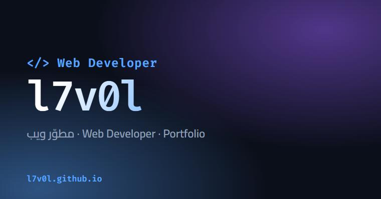

# l7v0l | Portfolio

موقعي الشخصي: مطوّر ويب، بتصميم متحرك وبلغتين (عربي / English).

**[🌐 افتح الموقع](https://l7v0l.github.io)**

## المميزات

- خلفية نقاط متحركة تتفاعل مع الماوس، وكتابة متحركة في الواجهة.
- **عربي وإنجليزي** مع دعم كامل لاتجاه RTL، ويُحفظ اختيارك.
- قسم **المشاريع** يقرأ مستودعاتي من GitHub تلقائياً، فأي مشروع جديد يظهر لحاله.
- متجاوب مع الجوال والتابلت والشاشات الكبيرة.
- يحترم إعداد "تقليل الحركة" في النظام.
- بدون مكتبات ولا خطوة بناء: HTML وCSS وJavaScript فقط.

## التخصيص

- النصوص والترجمات: الكائن `T` في `script.js`.
- اسم حساب GitHub لقسم المشاريع: المتغير `USER` في أول `script.js`.
- الألوان: المتغيرات في أعلى `style.css`.

## دعم المشروع

إذا أعجبك الموقع أو استفدت منه، أعطه ⭐ من أعلى الصفحة. وتقدر تستخدمه كقالب لموقعك، بس غيّر الأسماء والروابط.

## الترخيص

MIT
